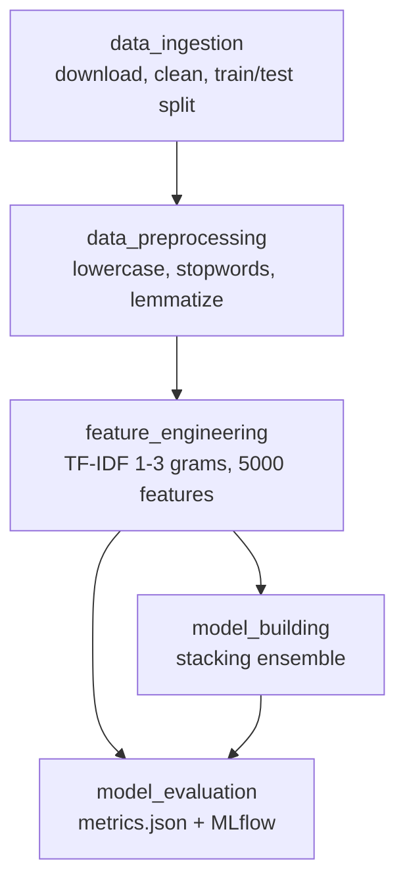

# yt-comment_sentiment_analysis

ML pipeline for a small Chrome plugin that detects the sentiment of YouTube comments.
The model is trained on ~37k labelled Reddit comments and classifies each comment as
**negative (-1), neutral (0) or positive (1)** using classic ML only (no deep learning).
Built as a reproducible pipeline with **DVC**, with experiments tracked in **MLflow**.

## Results (test set)

| Metric | Score |
|---|---|
| Macro F1 | 0.864 |
| Accuracy | 0.874 |
| F1 negative / neutral / positive | 0.795 / 0.912 / 0.885 |

Final model: stacking ensemble (LightGBM + LinearSVC + Logistic Regression + Complement Naive Bayes) with a Logistic Regression meta-model.

## Pipeline



## Approach

- Cleaned data: removed missing values, empty strings and duplicates; stratified 80/20 split.
- Compared Bag-of-Words vs TF-IDF and uni/bi/tri-grams, then tuned `max_features`.
- Tested imbalance techniques (class weights, SMOTE variants, under/over-sampling).
- Compared 7 algorithms (LogReg, LinearSVC, Complement NB, KNN, Random Forest, XGBoost, LightGBM), tuned with GridSearch and Optuna.
- Combined the best models with voting and stacking.
- Metric focus: macro F1 and negative-class F1 (the minority, hardest class).

## How to run

```bash
pip install -r requirements.txt
dvc repro              # runs only the stages whose inputs or params changed
dvc metrics show       # test scores
mlflow ui --backend-store-uri sqlite:///mlflow.db
```

All settings live in `params.yaml`.

## Tech stack
Python, scikit-learn, LightGBM, NLTK, DVC, MLflow, Optuna