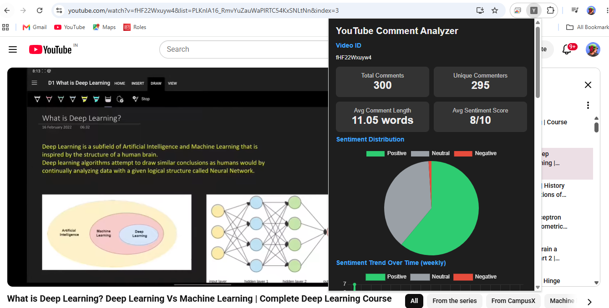
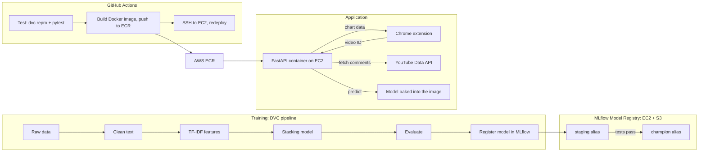

# Comment Sentiment Analysis: ML pipeline, API and Chrome extension


An end-to-end machine learning project that classifies comments as **negative, neutral or positive**, and shows the results for any YouTube video in a **Chrome extension**.

The model is a classic-ML **stacking ensemble** (no deep learning). The project focuses on doing the ML *properly* and taking it all the way to production: a reproducible DVC pipeline, experiment tracking and a model registry with MLflow, automated tests, a Docker image, and a CI/CD pipeline on GitHub Actions that builds the image, pushes it to AWS ECR and redeploys it to EC2.

> `

---

## Results

Evaluated on a held-out test set of 7,333 comments.

| Metric | Score |
|---|---|
| Macro F1 | **0.864** |
| Accuracy | 0.874 |
| F1, negative | 0.795 |
| F1, neutral | 0.912 |
| F1, positive | 0.885 |

Macro F1 is the headline metric because the classes are imbalanced (neutral dominates), so plain accuracy would hide weak performance on the negative class. The confusion matrix is in `reports/confusion_matrix.png`.

---

## Architecture



**Where things live**
- **GitHub:** code, `dvc.yaml`, `dvc.lock`, `params.yaml`, the CI/CD workflow
- **AWS S3:** DVC remote (data and model files) and MLflow artifacts
- **AWS EC2:** MLflow tracking server (model registry) and the API container, with a fixed Elastic IP
- **AWS ECR:** Docker images of the FastAPI backend, tagged with the commit ID and `latest`

---

## ML pipeline

The pipeline is defined in `dvc.yaml`. Every stage's inputs, outputs and parameters are tracked, so `dvc repro` reruns **only what changed**.

| Stage | What it does |
|---|---|
| `data_ingestion` | Downloads the dataset, drops missing values, duplicates and empty strings, makes the train/test split |
| `data_preprocessing` | Lowercases, removes special characters and stopwords (keeping sentiment words such as *not* and *but*), lemmatizes |
| `feature_engineering` | TF-IDF with 1-3 grams and 5,000 features, fitted on the training set only |
| `model_building` | Trains the stacking ensemble |
| `model_evaluation` | Computes metrics, saves the confusion matrix, logs the run and model (with a signature) to MLflow |
| `model_registration` | Registers the model as a new version in the MLflow registry with the `staging` alias |

All hyperparameters live in `params.yaml`.

### Model

A **stacking ensemble**: four different base learners whose predictions are combined by a logistic regression meta-model.

- LightGBM
- Linear SVM (probability-calibrated)
- Logistic Regression
- Complement Naive Bayes

---

## Model registry and promotion

Models move through **aliases** (MLflow 3 replaced the old fixed stages with aliases):

1. A new model is registered and gets the **`staging`** alias.
2. Tests run against `models:/yt-sentiment-stacking@staging`.
3. If they pass, `src/model/promote_model.py` moves **`champion`** to that version.
4. The previous champion is kept under **`previous`**, so rolling back is a one-line change.

---

## Testing

| File | What it checks |
|---|---|
| `tests/test_model_staging.py` | The staging model **loads** from the registry; has a valid **signature**; clears the **performance** bar (macro F1 >= 0.80 and every class F1 >= 0.70) |
| `tests/test_api.py` | `/` health check; `/predict` returns valid labels and rejects bad input; `/analyze` works with a **mocked** YouTube API |

The model tests need the MLflow server, so they run only when `MLFLOW_TRACKING_URI` is set. The API tests run everywhere, including CI.

---

## Backend API (FastAPI)

| Endpoint | Description |
|---|---|
| `GET /` | Health check |
| `POST /predict` | `{"comments": [...]}` returns a sentiment per comment |
| `POST /analyze` | `{"video_id": "..."}` fetches the video's comments and returns counts, trend, top comments and word frequencies |

Interactive docs are served at `/docs`.

---

## Docker

The backend ships as a Docker image (`Dockerfile`, with a slim `requirements-api.txt` instead of the full training environment).

- The trained model files are **baked into the image**, so the container is self-contained.
- NLTK data is downloaded at build time.
- The YouTube API key is **never** stored in the image. It is passed at run time (`--env-file` or `-e`).

```bash
docker build -t yt-sentiment-api .
docker run --rm -p 8000:8000 --env-file .env yt-sentiment-api
```

The model files come from DVC, so run `dvc pull` before building locally.

---

## CI/CD (GitHub Actions)

The workflow in `.github/workflows/ci.yaml` has three jobs:

| Job | Runs on | What it does |
|---|---|---|
| `test-pipeline` | every push and pull request | Installs dependencies, pulls data and models with `dvc pull`, runs `dvc repro` to confirm the pipeline matches `dvc.lock`, runs `pytest` |
| `build-and-push` | pushes to `master`, after the tests pass | Pulls the model files, builds the Docker image, pushes it to **Amazon ECR** tagged with the commit ID and `latest` |
| `deploy` | after `build-and-push` | Connects to the EC2 server over SSH, runs a script that pulls the new image and restarts the container, then checks that the API answers |

AWS credentials and the SSH key are stored as GitHub repository secrets. On the server, the container pulls from ECR using an IAM instance role, so no AWS keys are stored on the machine.

---

## Chrome extension

For the current YouTube video, the popup shows:

- Summary tiles: comments analysed, unique commenters, average comment length, average sentiment score (0-10)
- Sentiment distribution (pie chart)
- Sentiment trend over time (line chart)
- Word cloud of the most frequent words
- Top comments by likes, with their predicted sentiment

Charts are drawn in the browser with Chart.js from numbers returned by the backend. The extension talks to the API address set in `extension/popup.js` (`API`) and `extension/manifest.json` (`host_permissions`).

---

## Project structure

```
.
├── .github/workflows/ci.yaml   # test, build/push image, deploy
├── backend/app.py              # FastAPI service
├── extension/                  # Chrome extension (manifest, popup, Chart.js)
├── src/
│   ├── data/                   # ingestion and preprocessing
│   ├── features/               # TF-IDF feature engineering
│   └── model/                  # building, evaluation, registration, promotion
├── tests/                      # model and API tests
├── reports/                    # confusion matrix and experiment info
├── Dockerfile                  # backend image
├── requirements-api.txt        # slim dependencies for the image
├── dvc.yaml                    # pipeline definition
├── dvc.lock                    # exact versions of every pipeline output
└── params.yaml                 # all hyperparameters
```

---

## Getting started

**1. Set up**
```bash
git clone https://github.com/MansiBramta/yt-comment_sentiment_analysis.git
cd yt-comment_sentiment_analysis
python -m venv myenv
myenv\Scripts\activate            # Windows (Linux/macOS: source myenv/bin/activate)
pip install -r requirements.txt
pip install "dvc[s3]" pytest httpx
```

**2. Get the data and models** (needs AWS credentials for the S3 remote)
```bash
dvc pull
```

**3. Reproduce the pipeline**
```bash
dvc repro
```
By default, runs are tracked in a local SQLite database. To use a remote MLflow server, set `MLFLOW_TRACKING_URI` first.

**4. Run the backend**

Create a `.env` file in the project root with a YouTube Data API key:
```
YOUTUBE_API_KEY=your_key_here
```
Then either run it directly:
```bash
uvicorn backend.app:app --port 8000
```
or with Docker (see above). API docs are at `http://127.0.0.1:8000/docs`.

**5. Load the extension**

Set `API` in `extension/popup.js` and `host_permissions` in `extension/manifest.json` to your backend address (`http://127.0.0.1:8000` for local use). Open `chrome://extensions`, turn on **Developer mode**, click **Load unpacked** and choose the `extension` folder. Open a YouTube video and click the extension icon.

**6. Run the tests**
```bash
pytest tests/test_api.py -v
# model tests (need a reachable MLflow server):
set MLFLOW_TRACKING_URI=http://<your-mlflow-host>:5000
pytest tests/test_model_staging.py -v
```

**MLflow server** (on EC2, with AWS credentials in the environment)
```bash
mlflow server --host 0.0.0.0 --port 5000 --workers 1 \
  --backend-store-uri sqlite:////home/ubuntu/mlflow-data/mlflow.db \
  --artifacts-destination s3://<your-bucket>/mlflow-artifacts \
  --serve-artifacts \
  --allowed-hosts "<server-ip>:5000,localhost:5000" \
  --cors-allowed-origins "http://<server-ip>:5000"
```

---

## Limitations and next steps

- **Domain shift:** the model is trained on Reddit comments and applied to YouTube comments. Slang, emoji, sarcasm and non-English text (including Hinglish) are weaker spots. Hand-labelling a sample of YouTube comments would quantify the drop.
- Only **top-level comments** are analysed, capped at 300 per video.
- The API runs on a single small EC2 instance over plain HTTP, with no authentication or rate limiting.
- The deployed API serves the model baked into the image. It does not yet load the `champion` model from the registry at start-up.
- The MLflow server is private, so CI cannot run the registry tests; they run from a machine that can reach the server.
- Ideas: error analysis and a model-comparison table, a transformer model for comparison, multilingual support, HTTPS and rate limiting, loading the champion model from the registry, and a login-protected MLflow server so CI can run the registry tests and promotion.

## Tech stack

Python, scikit-learn, LightGBM, NLTK, DVC, MLflow, FastAPI, pytest, Docker, GitHub Actions, AWS (S3, EC2, ECR, IAM), Chrome Extension (Manifest V3), Chart.js